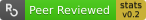

# Badges for software peer-review

This repository builds the status badges of packages submitted to [rOpenSci's
software peer review](https://github.com/ropensci/software-review/issues), and
serves them from [badges.ropensci.org](https://badges.ropensci.org).

Each badge is identified by the issue number of the submission in
`ropensci/software-review`. For example, [{epubr}](https://github.com/ropensci/epubr)
was reviewed in [issue 222](https://github.com/ropensci/software-review/issues/222),
so its badge is at `https://badges.ropensci.org/222_status.svg`:

The package reviewed in issue XYZ can then show its badge by linking to
`https://badges.ropensci.org/XYZ_status.svg`.

## How it works

The [`update-badges` workflow](.github/workflows/badges.yml) runs every 6 hours,
on every push to `main`, and on demand. It:

1. runs [`update_badges.R`](update_badges.R), which reads the labels of all
   issues in `ropensci/software-review` and copies the right badge from the
   [`svgs`](svgs) directory to `pkgsvgs/<issue-number>_status.svg`:
   - a statistical software badge for issues with a
     `6/approved-<grade>-v<version>` label, such as `6/approved-gold-v0.2`;
   - `peer-reviewed` for other issues labelled `6/approved`;
   - `pending` for issues at stages 3 to 5;
   - `unknown` for anything else.

   It also writes `pkgsvgs/json/onboarded.json`, a list of packages with their
   review status, read from the issue labels and from the `Package:` and
   `Version:` fields of each opening comment. Issues without a `Package:` field
   are reported in [issue 24](https://github.com/ropensci-org/badges/issues/24);
2. runs [`check-registry.R`](check-registry.R), which checks the package names
   in `onboarded.json` against the [rOpenSci
   r-universe](https://ropensci.r-universe.dev);
3. deploys the `pkgsvgs` directory to the `gh-pages` branch, which serves
   badges.ropensci.org.

Failures are reported in [issue 18](https://github.com/ropensci-org/badges/issues/18).

## Source badges

The source SVG files for all badges are in the [`svgs`](svgs) directory. Edit
them in a code (text) editor, not in an image editor. New badges are generally
created by copying an existing one and editing it.

### Statistical software badges

Badges for statistical software packages show the version of the [*Statistical
Software Standards*](https://stats-devguide.ropensci.org/standards.html) current
when the package was approved, coloured according to [the grade of standards
compliance](https://stats-devguide.ropensci.org/pkgdev.html#pkgdev-badges):
bronze, silver, or gold. They look like this:

Each new version of the standards needs three new badges in `svgs`, one per
grade, named `<grade>-v<version>.svg` (for example `gold-v0.3.svg`). Copy the
previous version's files and replace the version number near the end of each
file. Nothing else needs to change here: `update_badges.R` matches the labels to
the file names. The labels themselves (such as `6/approved-gold-v0.3`) are added
by `ropensci-review-bot` when a stats submission is approved, using the
`stats_badge` endpoint of
[`roreviewapi`](https://docs.ropensci.org/roreviewapi/reference/stats_badge.html),
which reads the current version of the standards.

## Adding a new kind of badge

1. Design the new badge and save it in [`svgs`](svgs).
2. Create the matching "approved" label in [the software-review
   repository](https://github.com/ropensci/software-review/labels). It must
   begin with `6/approved-`, followed by the new text (note the forward slash
   after "6").
3. Change the bot so that the `approve` command adds the new label to the
   issue. The [approve
   responder](https://github.com/ropensci-org/buffy/blob/ropensci/app/responders/ropensci/approve_responder.rb)
   of [rOpenSci's buffy](https://github.com/ropensci-org/buffy) shows how this
   is done for statistical software badges.
4. Change [`update_badges.R`](update_badges.R) so that it maps the new label to
   the new badge. Labels are currently mapped to badges in the section that
   builds `svg_name_map`.

After the script is updated, the workflow deploys the new badges and assigns
them to the matching review issues.
